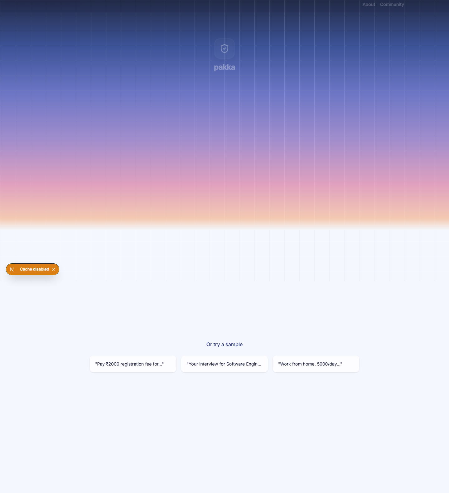
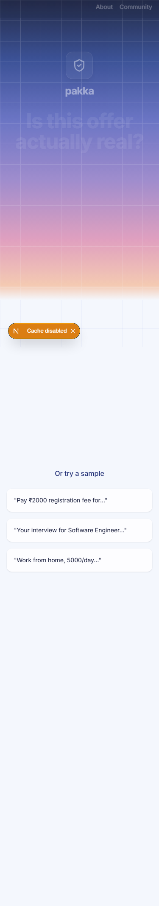
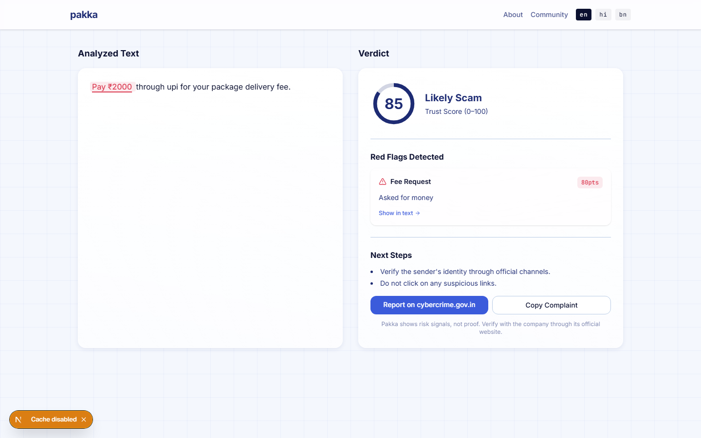
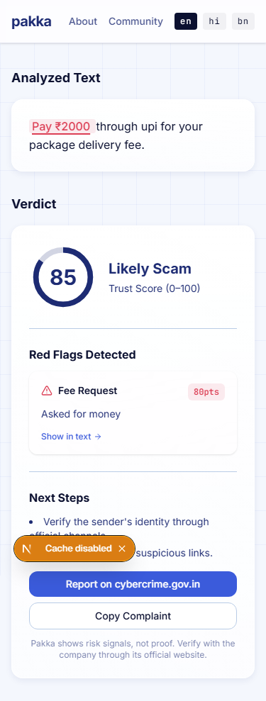
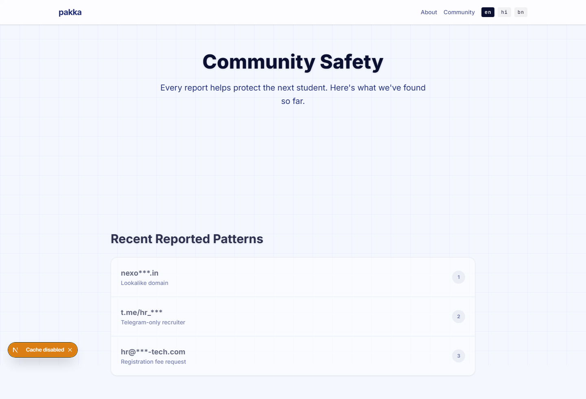
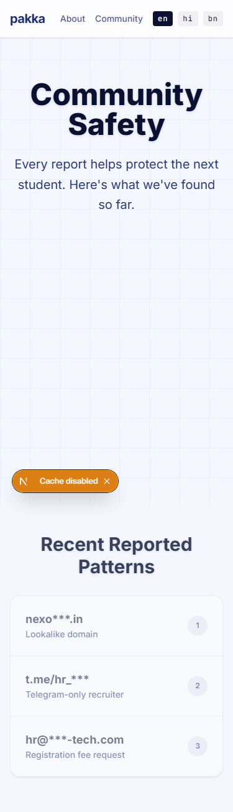
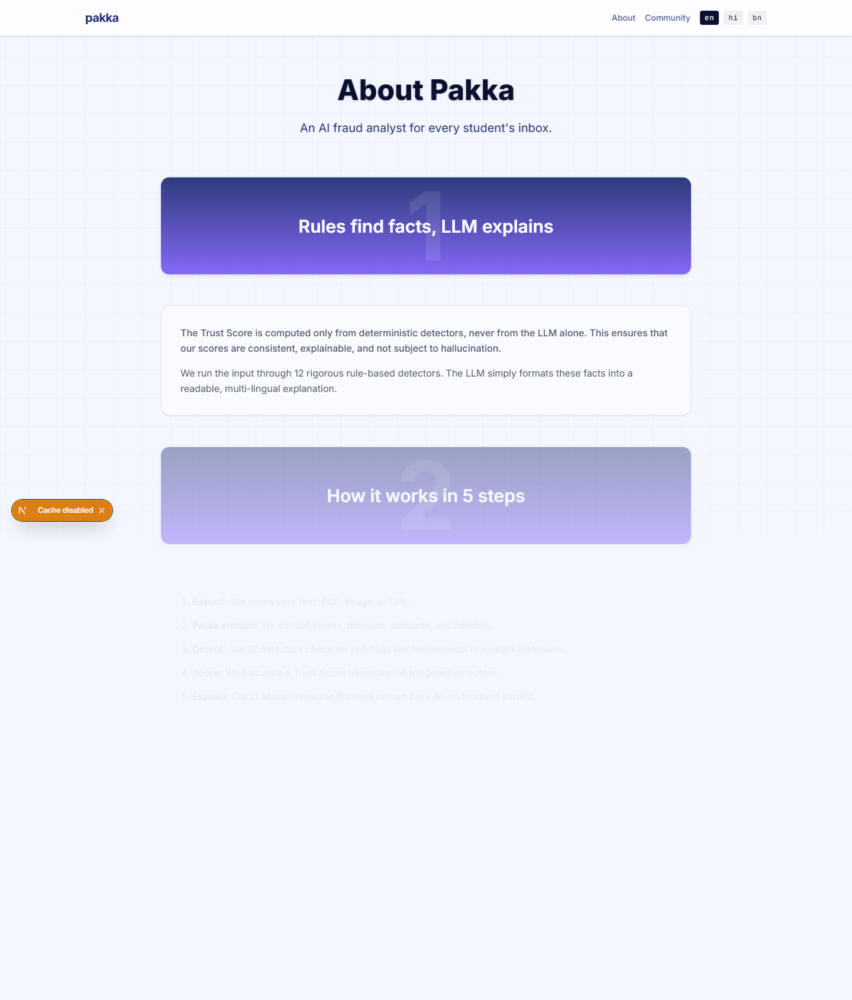
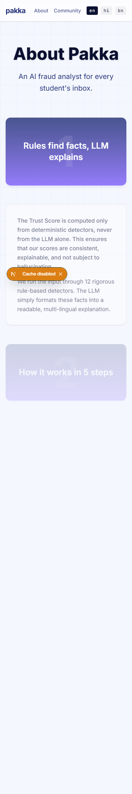
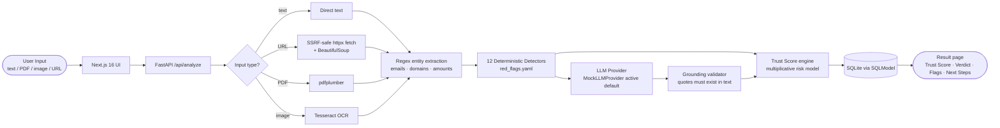

<div align="center">


<br/>

<p>
  
  
  
  
  
  
  
</p>

<p>
  <a href="#-overview"><strong>Overview</strong></a> ·
  <a href="#-features"><strong>Features</strong></a> ·
  <a href="#-how-it-works"><strong>How it works</strong></a> ·
  <a href="#-architecture"><strong>Architecture</strong></a> ·
  <a href="#-setup"><strong>Setup</strong></a> ·
  <a href="#-api-reference"><strong>API</strong></a> ·
  <a href="#-security"><strong>Security</strong></a> ·
  <a href="#-roadmap"><strong>Roadmap</strong></a>
</p>

</div>

---

## 🛡️ Overview

**Pakka** is an AI-assisted fraud analyst built for students and first-time job seekers in India. Every day, thousands of fake internship and job offers flood WhatsApp groups, email inboxes, and Telegram channels — demanding registration fees, threatening "limited seats," or dangling impossibly high salaries.

Pakka lets you **paste, upload, or screenshot** any suspicious offer and get back a **Trust Score** (0–100), a human-readable **verdict**, and a plain-language list of red flags — in English, Hindi, or Bengali.

> **The core principle:** Deterministic rule-based detection is the source of truth. An optional LLM can add explanations, but rules — not AI guesswork — drive the verdict.

---

## 📸 Screenshots

| View | Desktop (1440×900) | Mobile (375×812) |
|------|-------------------|------------------|
| **Home & Input Card** |  |  |
| **Analysis Result** |  |  |
| **Community Safety** |  |  |
| **About Pakka** |  |  |

---

## ✨ Features

| Feature | Details |
|---------|---------|
| **4 input modes** | Paste text · Upload PDF · Screenshot (PNG/JPG) · Paste URL |
| **12 fraud signal detectors** | Fee request · Free-mail sender · Lookalike domain · New domain · No interview · Urgency · Off-chat-only contact · Money forwarding · Unrealistic pay · Certificate/social demand · Vague company · Community-reported |
| **Trust Score** | 0–100 multiplicative risk model with hard floors for the two most dangerous signals |
| **3 verdicts** | `Looks Pakka` · `Be Careful` · `Likely Scam` |
| **3 languages** | English · हिन्दी · বাংলা — detection phrases and UI strings |
| **SSRF-safe URL fetch** | Private/loopback IPs blocked; 1 MB response cap; custom error messages |
| **Rate limiting** | 10 analyze/min per IP · 5 report/min per IP |
| **Community stats** | Aggregated counts of scams flagged and top patterns seen |
| **Framer Motion UI** | Animated hero gradient, staggered card entrances, tab underline spring, animated loading states |
| **Mock LLM mode** | Operational default provider with multilingual next-steps (English, Hindi, Bengali) |

---

## ⚙️ How it works



### Detection pipeline detail

1. **Extraction** — Emails, domains, monetary amounts, and Telegram/WhatsApp handles are extracted from the raw text using regex.
2. **Rule detectors** — Each of the 12 detectors is a stateless function that returns `True/False`. Phrases are loaded from `red_flags.yaml` and matched across English, Hindi, and Bengali vocabularies.
3. **Lookalike domain check** — Rapidfuzz Levenshtein distance ≤ 2 against a list of known legitimate company domains.
4. **Domain age check** — Domains registered within the last 90 days are flagged.
5. **Scoring** — Each triggered flag contributes a risk probability `p_i = weight/100`. Final trust = `round(100 × Π(1 – p_i))`, capped to ≤ 25 if `fee_request` or `money_forwarding` fires.
6. **LLM analysis** — The active runtime uses `MockLLMProvider` to generate next steps (and tone checks when simulated). All quotes are verified by the grounding validator against the source text before inclusion. (Note: `GeminiProvider` exists as an experimental class but is not wired into the `/api/analyze` controller).
7. **Verdict** — `≥ 70` → Looks Pakka · `40–69` → Be Careful · `< 40` → Likely Scam. (Short/meaningless inputs receive `Insufficient Information`).

---

## 🗂️ Architecture

```
pakka/
├── backend/
│   ├── app/
│   │   ├── main.py              # FastAPI app, CORS, rate-limit middleware
│   │   ├── config.py            # Pydantic settings (reads .env)
│   │   ├── models.py            # AnalysisRecord SQLModel table
│   │   ├── api/
│   │   │   ├── analyze.py       # POST /api/analyze, GET /api/stats, etc.
│   │   │   └── health.py        # GET /health
│   │   ├── core/
│   │   │   ├── scoring.py       # Trust score + verdict engine
│   │   │   ├── schema.py        # Pydantic response models
│   │   │   └── i18n.py          # YAML-backed translation loader
│   │   ├── intel/
│   │   │   ├── detectors.py     # 12 deterministic detector functions
│   │   │   ├── lookalike.py     # Rapidfuzz Levenshtein domain check
│   │   │   └── domain_age.py    # Domain registration age check
│   │   ├── ingest/
│   │   │   ├── url_fetch.py     # SSRF-safe httpx fetcher
│   │   │   ├── image_ocr.py     # Tesseract OCR (PNG/JPG)
│   │   │   └── pdf.py           # pdfplumber text extraction
│   │   ├── llm/
│   │   │   ├── provider.py      # Abstract LLM base
│   │   │   ├── mock.py          # Default mock (no API calls)
│   │   │   ├── gemini.py        # Optional Gemini stub
│   │   │   └── grounding.py     # Quote validation
│   │   └── data/
│   │       ├── red_flags.yaml   # 12 fraud signals, weights, phrases (en/hi/bn)
│   │       ├── companies.json   # Known legitimate domain list
│   │       ├── i18n_en.yaml     # English UI strings
│   │       ├── i18n_hi.yaml     # Hindi UI strings
│   │       └── i18n_bn.yaml     # Bengali UI strings
│   ├── tests/                   # pytest unit + integration tests
│   ├── pyproject.toml           # Dependencies + build config
│   └── .env.example             # Safe environment variable template
│
├── frontend/
│   ├── src/
│   │   ├── app/
│   │   │   ├── page.tsx         # Home — hero + InputCard + feature tiles
│   │   │   ├── layout.tsx       # Root layout with Header
│   │   │   ├── globals.css      # CSS custom properties / design tokens
│   │   │   ├── result/[id]/     # Dynamic result display page
│   │   │   ├── community/       # Community safety stats page
│   │   │   └── about/           # About page
│   │   ├── components/
│   │   │   ├── InputCard.tsx    # 4-tab input (text/pdf/screenshot/link)
│   │   │   ├── Header.tsx       # Navigation
│   │   │   ├── GlassTile.tsx    # Glass-morphism card primitive
│   │   │   ├── GridBackground.tsx # Subtle grid overlay
│   │   │   ├── HighlightedText.tsx # Flag evidence highlighting
│   │   │   ├── LangSwitch.tsx   # en / hi / bn switcher
│   │   │   └── SectionBand.tsx  # Section divider
│   │   └── lib/
│   │       ├── api.ts           # Frontend fetch wrappers
│   │       └── i18n.ts          # i18n context hook
│   └── package.json             # Next.js 16, Framer Motion, Tailwind CSS 4
│
└── docs/
    ├── RELEASE_AUDIT.md         # Security and feature audit log
    └── assets/                  # Screenshots (add before publishing)
```

---

## 🖥️ Tech Stack

| Layer | Technology | Declared Version / Constraint |
|-------|-----------|-------------------------------|
| **Frontend framework** | Next.js (App Router) | `16.4.0` |
| **UI library** | React / React DOM | `19.3.0` |
| **UI language** | TypeScript | `^5` |
| **Styling** | Tailwind CSS | `^4` (`@tailwindcss/turbopack ^4`) |
| **Animations** | Framer Motion | `^14.0.0` |
| **Icons** | lucide-react | `^1.54.0` |
| **Backend framework** | FastAPI | `>=0.111.0` |
| **Runtime** | Python | `>=3.11` |
| **Database ORM** | SQLModel + SQLite | `>=0.0.18` |
| **HTTP client** | httpx | `>=0.27.0` |
| **PDF extraction** | pdfplumber | `>=0.11.0` |
| **OCR** | pytesseract + Pillow | `>=0.3.10` / `>=10.3.0` |
| **String matching** | rapidfuzz | `>=3.9.1` |
| **Rate limiting** | slowapi | `>=0.1.9` |
| **HTML parsing** | beautifulsoup4 | `>=4.12.3` |
| **Multipart parsing** | python-multipart | `>=0.0.9` |
| **Config** | pydantic-settings | `>=2.2.1` |
| **E2E testing** | Playwright | `^1.64.0` |
| **Backend testing** | pytest + pytest-asyncio | `>=8.2.0` / `>=0.23.6` |

---

## 🚀 Setup

### Prerequisites

- **Node.js** ≥ 18 and **npm** (or pnpm)
- **Python** ≥ 3.11
- **Tesseract OCR** (only required for screenshot/image analysis)
  - Windows: download installer from [UB Mannheim](https://github.com/UB-Mannheim/tesseract/wiki) and install to the default path `C:\Program Files\Tesseract-OCR\`
  - macOS: `brew install tesseract`
  - Ubuntu/Debian: `sudo apt install tesseract-ocr`

---

### 1. Clone the repository

```bash
git clone https://github.com/ankush-dev-eng/pakka.git
cd pakka
```

---

### 2. Backend setup

```bash
cd backend

# Create and activate a virtual environment
python -m venv .venv

# Windows PowerShell
.venv\Scripts\Activate.ps1

# macOS / Linux
source .venv/bin/activate

# Install dependencies
pip install -e ".[dev]"

# Copy and review the environment template
copy .env.example .env        # Windows
# cp .env.example .env        # macOS/Linux

# Start the API server (auto-reloads on change)
uvicorn app.main:app --reload --port 8000
```

The API will be available at `http://localhost:8000`. Interactive docs at `http://localhost:8000/docs`.

> **Working default:** The backend uses `MockLLMProvider` as the operational runtime default. In `app/api/analyze.py`, the analysis pipeline directly instantiates `MockLLMProvider()`. While a `GeminiProvider` class exists in `app/llm/gemini.py` with structured output parsing, live Gemini analysis is not currently wired into the endpoint dispatch or tested end-to-end. Mock mode remains the working default without requiring external API keys.

---

### 3. Frontend setup

```bash
cd frontend

# Install dependencies
npm install

# Start the development server
npm run dev
```

The UI will be available at `http://localhost:3000`.

---

### 4. Environment variables reference

| Variable | Default | Description |
|----------|---------|-------------|
| `PAKKA_LLM` | `mock` | LLM provider: `mock` (active default) or `gemini` (experimental / not wired to analyze endpoint) |
| `GEMINI_API_KEY` | _(empty)_ | Not required for default mock runtime. Set only when developing Gemini integration |
| `GEMINI_MODEL` | `gemini-2.5-flash` | Gemini model identifier |
| `DATABASE_URL` | `sqlite:///./pakka.db` | SQLite database path |
| `BACKEND_CORS_ORIGINS` | `["http://localhost:3000"]` | Allowed frontend origins |
| `TESSERACT_PATH` | _(auto-detected)_ | Override Tesseract binary path |

---

## 📡 API Reference

> Base URL: `http://localhost:8000`

### `POST /api/analyze`

Analyzes a job/internship offer. Accepts `multipart/form-data`.

**Fields:**

| Field | Type | Required | Description |
|-------|------|----------|-------------|
| `text` | `string` | One of three | Raw offer text (≤ 10,000 chars) |
| `url` | `string` | One of three | Public URL to fetch and analyze |
| `file` | `file` | One of three | PDF or PNG/JPG image |
| `lang` | `string` | No (default `en`) | Language hint: `en`, `hi`, or `bn` |

Exactly **one** of `text`, `url`, or `file` must be provided.

**Example — text analysis:**

```bash
curl -X POST http://localhost:8000/api/analyze \
  -F "text=Pay ₹2000 registration fee via UPI to proceed with selection." \
  -F "lang=en"
```

**Example — PDF upload:**

```bash
curl -X POST http://localhost:8000/api/analyze \
  -F "file=@offer_letter.pdf" \
  -F "lang=en"
```

**Response:**

```json
{
  "id": "uuid-here",
  "text": "Pay ₹2000 registration fee via UPI to proceed with selection.",
  "lang": "en",
  "score": 25,
  "verdict": "likely_scam",
  "flags": [
    {
      "id": "fee_request",
      "title": "Fee Request",
      "reason": "Rule matched.",
      "weight": 70,
      "source": "rule"
    }
  ],
  "llm_flags": [],
  "next_steps": [
    "Verify the sender's identity through official channels.",
    "Do not click on any suspicious links."
  ],
  "reported_scam": false,
  "reported_genuine": false,
  "created_at": "2026-10-12T08:41:00Z"
}
```

---

### `GET /api/analyze/{id}`

Retrieve a previously stored analysis result by its UUID.

---

### `POST /api/report/{id}`

Submit user feedback on a result.

```json
{ "type": "scam" }
```
or
```json
{ "type": "genuine" }
```

---

### `GET /api/stats`

Returns aggregate community statistics.

```json
{
  "total_analyzed": 42,
  "likely_scams": 18,
  "top_patterns": [
    { "name": "Fee Request", "count": 11 },
    { "name": "Urgency", "count": 7 }
  ]
}
```

---

### `GET /health`

```json
{ "status": "ok" }
```

---

## 🧪 Testing

```bash
cd backend
python -m pytest tests/ -v
```

Test files cover:

| File | Coverage area |
|------|---------------|
| `test_api.py` | API endpoint integration tests |
| `test_detectors.py` | Individual detector functions |
| `test_scoring.py` | Trust score + verdict thresholds |
| `test_intel.py` | Lookalike and domain intel |
| `test_ingest.py` | URL fetch, PDF, OCR ingest modules |
| `test_i18n.py` | Translation loader |
| `test_llm_grounding.py` | LLM quote validation |
| `test_fixtures.py` | Fixture-based detector accuracy |
| `test_fixtures_accuracy.py` | Accuracy across scam/genuine fixture sets |
| `test_insufficient_info.py` | Edge-case: short/uninformative input |

**Frontend E2E** (requires running backend + frontend):
```bash
cd frontend
npx playwright test
```

---

## 🔒 Security & Privacy

- **No secrets in frontend** — all API keys and LLM credentials remain server-side. The browser sends only offer text and receives structured analysis results.
- **SSRF protection** — URL fetch resolves hostnames and blocks private/loopback IPs (RFC 1918, IPv6 link-local, loopback) before making any network request.
- **Rate limiting** — `slowapi` enforces 10 analyze requests/minute and 5 report requests/minute per IP address.
- **Input size limits** — Text is capped at 10,000 characters. URL responses are capped at 1 MB.
- **Database** — Analysis records are stored locally in SQLite. The raw offer text **is stored** server-side (needed for feedback linking). Do not deploy with sensitive data in production without a proper data retention policy.
- **User verification disclaimer** — Pakka is a decision-support tool. It can miss novel scam patterns or occasionally flag legitimate offers. Always verify independently through official company websites and portals (e.g. [cybercrime.gov.in](https://cybercrime.gov.in/)).

---

## 🎨 Theme & Motion Design

Pakka's visual identity uses a **dawn gradient palette** — deep navy through royal blue, violet, rose, and warm peach — reflecting the moment a student reads a suspicious morning message.

| Token | Color | Use |
|-------|-------|-----|
| `--ink` | `#10183F` | Primary text, headings |
| `--blue` | `#3549A6` | Primary actions, interactive focus |
| `--violet` | `#7862D9` | Accent, icon highlights |
| `--rose` | `#D993B8` | Warning tones, scam indicators |
| `--peach` | `#F4C6A8` | Warm accent |
| `--paper` | `#F3F6FF` | Surface / background |

**Implemented Framer Motion effects:**
- Hero gradient breathe animation (`opacity` oscillation, 5 s infinite)
- InputCard entrance: `scale(0.95) → scale(1)` + fade-up on mount
- Tab active-indicator: `layoutId="activeTab"` spring underline
- Feature tile grid: staggered `whileInView` fade-up children
- Community page: staggered card entrances with `viewport={{ once: true }}`
- Loading spinner on analyze button
- AnimatePresence for error message mount/unmount

---

## 🗺️ Roadmap

### Current capabilities
- Text, PDF, and URL input modes fully functional; Screenshot/Image mode wired via `pytesseract` (requires system-level Tesseract binary installation)
- 12 deterministic fraud detectors (English, Hindi, Bengali)
- Multiplicative trust score with hard floor capping for fee requests and money forwarding
- Community stats aggregation
- Mock LLM mode (operational default with multilingual next steps)
- Unit and integration tests (31 passed, 1 skipped when Tesseract is uninstalled)

### Known limitations & future work
- [ ] **OCR Execution Prerequisite**: Screenshot/image OCR requires external Tesseract-OCR binary installed on host; skipped in test environments where binary is absent
- [ ] **LLM Endpoint Wiring**: `/api/analyze` currently instantiates `MockLLMProvider()` directly; Gemini structured generation is implemented in `gemini.py` but not wired to runtime endpoint dispatch or tested live
- [ ] Crowd-sourced blocklist for `community_reported` detector
- [ ] Downloadable PDF report pack
- [ ] Official portal deep-links (Ministry of Labour, cybercrime.gov.in) per verdict
- [ ] Browser extension for in-context scanning
- [ ] More regional language support (Tamil, Telugu, Marathi)
- [ ] Configurable thresholds via admin panel

---

## 🤝 Contributing

Contributions are welcome! Please:
1. Fork the repository
2. Create a feature branch (`git checkout -b feat/your-feature`)
3. Commit with [Conventional Commits](https://www.conventionalcommits.org/) style messages
4. Open a pull request with a clear description

For bug reports and feature requests, please use [GitHub Issues](https://github.com/ankush-dev-eng/pakka/issues).

---

## 📄 License

No license has been specified for this repository. All rights are reserved by the author by default. If you would like to use, adapt, or redistribute this project, please contact the repository owner.

---

## 🙏 Acknowledgements

- [UB Mannheim Tesseract](https://github.com/UB-Mannheim/tesseract) for the Windows OCR installer
- [pdfplumber](https://github.com/jsvine/pdfplumber) for reliable PDF text extraction
- [rapidfuzz](https://github.com/maxbachmann/RapidFuzz) for fast fuzzy string matching
- [slowapi](https://github.com/laurentS/slowapi) for FastAPI rate limiting
- [Framer Motion](https://www.framer.com/motion/) for the animation system
- [cybercrime.gov.in](https://cybercrime.gov.in/) — the official Indian cyber-crime reporting portal referenced in next steps

---

<div align="center">


**pakka** &nbsp;·&nbsp; *Check before you accept.*

Built with care for every student navigating India's internship landscape.

</div>
